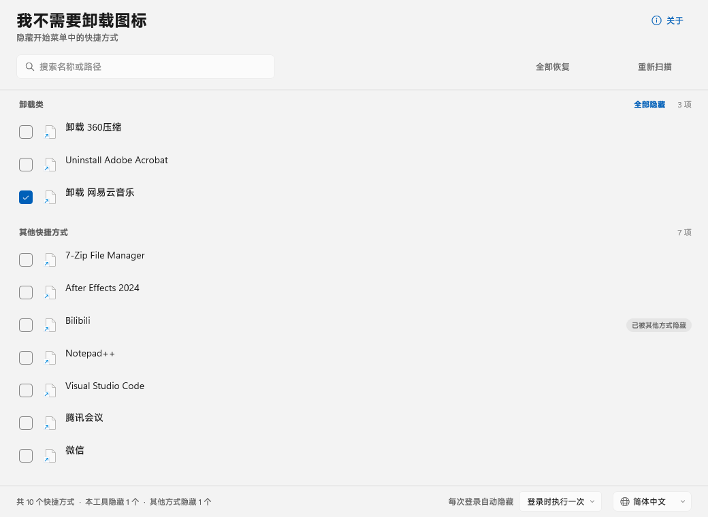
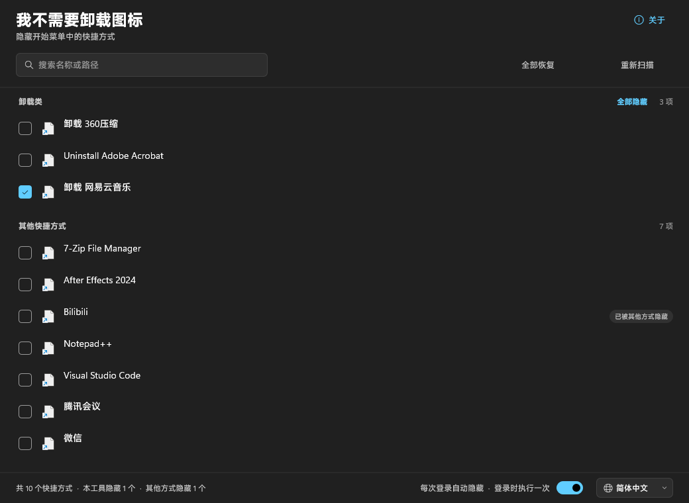
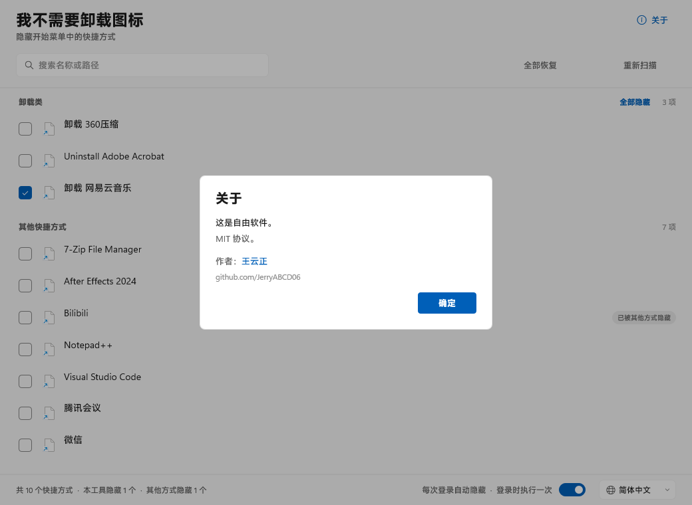
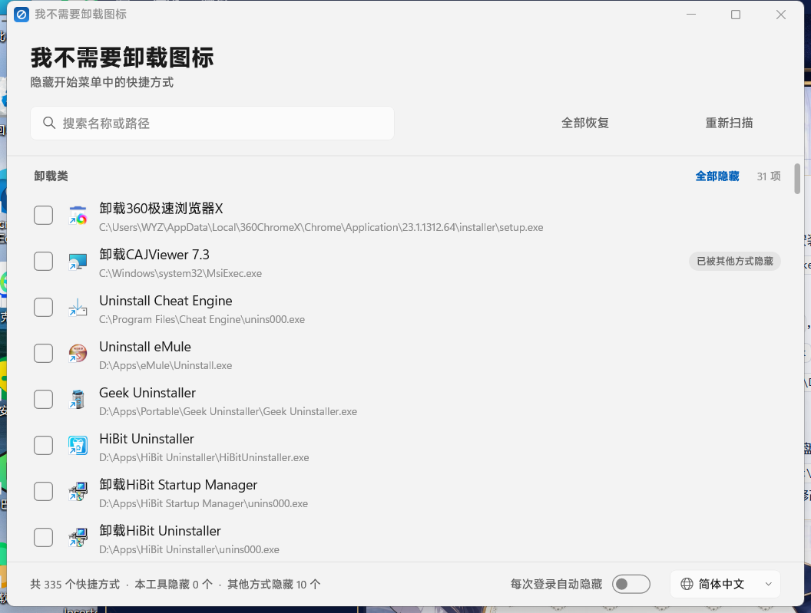

# No Uninstall Icon (我不需要卸载图标)

**English** | [简体中文](README.zh-CN.md)

A small, dependency-free Windows utility that hides selected Start menu shortcuts by
setting the `FILE_ATTRIBUTE_HIDDEN` bit on the shortcut file.

Written in C++20 with the Windows SDK only: no .NET, no Electron, no third-party
libraries. The window is drawn with Direct2D/DirectWrite on a DirectComposition
surface so it can use the Windows 11 Mica backdrop.

Runs on 64-bit Windows 10 (1809 or newer) and Windows 11. Nothing is installed to run it:
the executable is self-contained, and the Mica backdrop is used where the system offers
it, with a plain surface underneath where it does not.



| Dark theme | About | Real window (Mica) |
|---|---|---|
|  |  |  |

## Documentation

This README is the overview. The details live in `docs/`; if you are reading the code for the first time, start with *architecture*, then *internals*.

| Document | What is in it |
|---|---|
| [docs/architecture.md](docs/architecture.md) | the processes, the state machine, the shared objects, the locking and reconciliation rules, the threading map, a module-by-module map, two end-to-end walkthroughs and a glossary |
| [docs/state-file.md](docs/state-file.md) | every file the program writes: `state.dat` grammar and escaping, `state.lock`, the log, crash dumps, what is *not* stored |
| [docs/win32-notes.md](docs/win32-notes.md) | the parts that are only difficult on Windows: the tray protocol version 4, integrity levels and UIPI, DPI, DirectComposition and Mica, hand-written hit testing, UI Automation, the scheduled task's exact settings |
| [docs/build.md](docs/build.md) | building, where the version lives, the signing policy, packaging, the uninstall order, the language-file format |
| [docs/testing.md](docs/testing.md) | the environment variables, the test modes, a self-test recipe, what cannot be checked headlessly, a five-minute manual pass |
| [docs/troubleshooting.md](docs/troubleshooting.md) | symptom → cause → check, starting with how to turn the log on |
| [docs/internals.md](docs/internals.md) | the rendering layer: the D3D11/D2D/DirectComposition stack, Mica, the painter, layout constants, the display list and how the list stays cheap, the icon worker, off-screen rendering |

## What it does

* Lists every `.lnk` and `.url` under the per-user and all-users Start menu trees
  (`FOLDERID_Programs` and `FOLDERID_CommonPrograms`, resolved through the known
  folder API so redirected profiles work).
* Splits the list into two groups: entries whose name/target looks like an uninstall
  entry, and everything else. Both groups are sorted with the user's collation
  (`CompareStringEx` + `SORT_DIGITSASNUMBERS`), so Chinese names sort by pinyin,
  Japanese by kana, and `App 2` sorts before `App 10`. A leading or trailing
  uninstall word is stripped before sorting, so `卸载 Visual Studio Code` files under
  *V*.
* The checkbox means **"hide this shortcut"**. It reflects only what this tool
  manages, never the current attribute of the file.
* Toggling applies immediately, with an undo toast.
* Optional "hide automatically on sign-in": a Task Scheduler task, created without a
  UAC prompt at sign-in, re-applies the list. Either once per sign-in or as a
  resident watcher that reacts to directory changes.

## Three states, not two

This is the part that makes the tool safe to use:

| State | Checkbox | Badge |
|---|---|---|
| Not hidden | unchecked | – |
| Hidden by something else (installer, another tool, the user) | unchecked | "Hidden elsewhere" |
| Managed by this tool | checked | – |

Every managed record stores the **original attributes** of the shortcut. Unchecking
restores the previous hidden bit instead of blindly clearing it, so a shortcut that
was already hidden before this tool touched it stays hidden when it is released.

## Using the window

The list holds everything under the two Start menu trees, in two groups: *Uninstall
entries* and *Other shortcuts*. Each header shows its count; the uninstall group's header
also carries **Hide all / Unhide all**. The toolbar has **Unhide everything** and
**Rescan**; the search box filters on name and path as you type; the footer reports the
totals (`335 shortcuts · 0 hidden by this tool · 11 hidden elsewhere`).

The mode dropdown is the "hide automatically" switch:

| Mode | What it does |
|---|---|
| Off | nothing runs in the background, and the sign-in task is removed |
| Once at sign-in | runs `--apply` once per sign-in, then exits |
| Keep watching | runs `--background`: re-applies when the Start menu changes, and shows a tray icon |
| Watch (no tray icon) | the same, without the icon |

The language dropdown lists **System** — follow the Windows display language — followed by
every embedded language. Choosing one applies immediately and is remembered.

Right-clicking a row offers the toggle and *Open shortcut location*.

### Keyboard

| Key | Action |
|---|---|
| `Up` / `Down` | move the selection by one entry |
| `Home` / `End` | first / last entry |
| `PgUp` / `PgDn` | one screen up or down; the selection moves with it |
| `Space` | hide or unhide the selected entry |
| `Enter` | open the selected shortcut's location |
| `Apps`, `Shift+F10` | context menu for whatever has focus |
| `Ctrl+F` | jump to the search box |
| `Tab` / `Shift+Tab` | move between the search box, the list and the toolbar |
| `Esc` | in the search box: clear the selection, then the text, then leave; otherwise close the About dialog |

### The tray menu

When the mode shows an icon, the notification-area menu has exactly two commands:
**Open** (also a single or double click on the icon) and **Quit**.
Quit closes the window first, then removes the icon and stops the watcher — it does not
change the mode, so watching starts again the next time the window is opened or at the
next sign-in.

## What it does not cover

* **Pinned tiles.** Pins are stored separately (`Quick Launch\User Pinned\StartMenu`
  plus a registry/CloudStore list), so hiding the All-apps shortcut does not unpin
  anything. Only the All-apps list is affected.
* **Packaged (Store/UWP) apps.** They have no shortcut file and cannot be hidden this
  way.
* **"Show hidden files" in Explorer** may make hidden shortcuts visible again in some
  builds; the tool does not fight that setting.

## Files

| Path | Purpose |
|---|---|
| `%LOCALAPPDATA%\NoUninstallIcon\state.dat` | Managed records and settings (tab separated, escaped, atomically replaced) |
| `%LOCALAPPDATA%\NoUninstallIcon\state.dat.bak` | Copy of the previous save, used if the primary file is damaged |
| `%LOCALAPPDATA%\NoUninstallIcon\state.lock` | Empty file used for the cross-session lock |
| `%LOCALAPPDATA%\NoUninstallIcon\log.txt` | Written only with `--log` or `NOUI_LOG=1`; deleted once it passes 1 MB |
| Task `NoUninstallIcon-AutoHide` | Sign-in task, created only when the user enables it |

## Portable mode

Drop a file named `portable` next to `NoUninstallIcon.exe` and the program keeps
everything in `<exe folder>\data` instead of the user profile. The portable archive in
`dist/` ships that marker; delete it to go back to the normal location. If the folder
is not writable (a CD, a locked share) the program falls back to `%LOCALAPPDATA%`
instead of failing.

`NOUI_DATA_DIR` overrides both choices and is what the tests use.

The archive also carries `Reset.cmd`. Run it to undo everything the program did —
every hidden shortcut gets its original attributes back, the sign-in task is removed and
the watcher stops — without deleting the program. It asks for elevation once, because
shortcuts under `%ProgramData%` and the scheduled task need it. This is the portable
equivalent of uninstalling: the folder itself is yours to delete afterwards.

The sign-in task stores an absolute path, so enabling automatic hiding while running
from a removable drive will break once the drive letter changes.

## Build

Packaging, versioning and signing are covered in [docs/build.md](docs/build.md).

Requirements: MSVC (VS 2022/2026 with the C++ desktop workload) and the Windows 10/11
SDK. No NuGet packages are used.

```bat
build.bat            :: release, unsigned
build.bat debug      :: debug
build.bat sign       :: also signs the build with .signing\NoUninstallIcon.pfx
```

Output: `build\NoUninstallIcon.exe` (~560 KB, statically linked C runtime).

Signing is for local testing only. A self-signed binary carries the publisher
"王云正" with no chain to a trusted root, so Windows shows it as an unknown
publisher and SmartScreen trusts it no more than an unsigned file; a release
build is therefore left unsigned, and `tools\package.ps1` refuses to package a
signed one.

## Installer

The uninstall order and the cleanup hook are described in [docs/build.md](docs/build.md).

```bat
powershell -File tools\package.ps1        :: installer and portable zip, unsigned
```

Output: `dist\NoUninstallIcon-Setup-0.1.1.exe` and
`dist\NoUninstallIcon-portable-0.1.1.zip`. The installer follows the system dark/light
theme, offers all eleven languages the program has, and shows the product name in the
language chosen for the install. It adds no "uninstall" shortcut to the Start menu:
that menu is what this program cleans up. Use *Settings → Apps* to remove the product.
The uninstaller runs
`NoUninstallIcon.exe --cleanup` first, which deletes the sign-in task and gives every
managed shortcut its original attributes back.

## Command line

| Flag | Meaning |
|---|---|
| *(none)* | Normal window. Relaunches itself elevated once. |
| `--apply` | Apply the stored list silently and exit (used by the sign-in task). |
| `--watch`, `--background` | Run the watcher: apply once, then watch both Start menu trees and re-apply on change. Owns the tray icon when the stored mode wants one. |
| `--background --no-tray` | Same, and never shows an icon whatever the mode says. |
| `--restore` | Restore every managed shortcut and forget them. |
| `--cleanup` | Remove the sign-in task, then `--restore` (used by the uninstaller). |
| `--stop-watcher` | Ask a running watcher to leave, without touching the stored mode (used by the installer before it replaces the executable). |
| `--screenshot <png> [--theme light\|dark] [--about]` | Off-screen render of the window, for testing. |
| `--capture <png>` | Show the real window, grab it to PNG, exit. |
| `--dump <txt>` | Scan and write a classification report. |
| `--selftest` | Hide/unhide a fixture entry and verify the invariants. |
| `--log` | Write `log.txt`. Also passed to a watcher this run starts, and to the elevated copy of the window. `NOUI_LOG=1` does the same from the environment; `NOUI_LOG=0` keeps it off. |

The watcher obeys the stored mode, it does not choose it. With the mode set to
*Off* or *Once* it applies nothing and returns, because those modes are defined as
having no watcher; only *Watch* and *Silent* want one. `--background` is what the
sign-in task runs, `--watch` is an accepted alias, and neither switches the mode
on: the mode is set in the window and stored in `state.dat`.

`--screenshot`, `--dump` and `--selftest` do not request elevation. `--screenshot`
and `--dump` change nothing. `--selftest` hides and unhides a fixture entry, so
point `NOUI_DATA_DIR` and `NOUI_SCAN_ROOT` at a temporary directory before running
it. `--capture` renders the real window, which means it also runs the start-up
reconciliation: use it with a temporary data directory too.

## How the pieces agree

The full model, including the locking and reconciliation rules, is in [docs/architecture.md](docs/architecture.md).

There is exactly one piece of persisted truth: `state.dat`. Everything else is
derived from it and can be rebuilt from it.

| Mode | Sign-in task | Watcher process | Tray icon |
|---|---|---|---|
| Off | none | none | none |
| Once | `--apply` | none | none |
| Watch | `--background` | one | shown |
| Watch (no tray) | `--background` | one | none |

The task always starts a plain `--background` watcher; whether the icon appears
is decided by the mode it is told, not by how it was launched. A watcher started
by hand with `--no-tray` never shows an icon in any mode.

Writers serialise on two levels: a named mutex for the session, and a byte-range
lock on `state.lock` beside the data file (best effort: if the directory is read-only
the session mutex alone still applies), because the mutex is per session while
`state.dat` is per user and can even live on a share. Nested transactions on one
thread (undo calls the toggle path) share the outer file lock.

The mode travels through a small shared section (`Local\NoUninstallIcon.State`,
a version and the mode) plus a manual-reset event
(`Local\NoUninstallIcon.Changed`). The manual reset means a change published
while nobody was listening is still seen later; the watcher clears the event
*before* reading the mode, so a publish that lands during the read sets it again
and is not lost. Shared memory is used rather than a window message because the
watcher runs elevated and window messages are filtered between integrity levels.

The watcher never writes the state file. Applying hidden attributes used to save
it as well, which rewrote the settings the watcher does not own and could revert
a mode change made in the window; the applied timestamp is now only written when
the window saves.

Ownership is what stops the two processes undoing each other:

- **The window** writes the task, writes the state file, and decides whether a
  watcher should exist.
- **The watcher** owns its icon, applies the hidden attributes, and exits when
  the published mode no longer wants it. It never writes the task.
- **Repairs never change the mode.** Re-adding a lost icon or starting a missing
  watcher is derived work; only the dropdown and the tray's Quit touch the mode.

Reconciliation happens on:

| Trigger | Who | What it fixes |
|---|---|---|
| Start-up | window | re-creates a missing task, starts a missing watcher |
| Mode change | window → watcher | watcher adds or removes its icon, or exits; no restart |
| `TaskbarCreated` | watcher | re-adds the icon after Explorer restarts |
| Tray Quit | watcher | closes the window first, waits for it, then exits; the mode is left alone |

A watcher that dies while the window is closed is only noticed at the next
start-up or the next sign-in. There is no third watchdog process, by design.
Not yet implemented: a watcher that dies **while the window is open** is not
noticed either. The fix would be to hold a handle to the mutex the watcher owns
and wait on it, so the wait returns when the owner dies; that is a kernel
notification rather than polling, but it is not in yet.

Only the mode travels in the broadcast; the shortcut records are still read from
disk when the watcher applies them, because a few hundred records do not belong
in a message.

## Why there are two processes

The window is a Direct3D 11 / Direct2D / DirectComposition program. Measured on a
release build: 82.0 MB working set, 57.2 MB private, 112 loaded modules. The
watcher, which never touches a graphics API, is 14.3 MB working set and **2.5 MB
private** across 40 modules.

The window is only open while settings are being changed. The rest of the time
the resident cost of the product is the watcher's 2.5 MB.

That is the whole argument for the split. One process would keep the graphics
stack resident (57 MB), or would have to destroy and recreate its device every
time the window is hidden, with the device-loss handling that implies.

The price is everything in the section above: a shared section and event to carry
the mode, a named lock around the state file, two singleton mutexes and a
reconciliation pass at start-up. That price is bounded, because the program has
four modes, one watcher and one tray icon and is not going to grow. Merging it
back into one process is a reasonable choice for a lighter user interface; it was
considered here and rejected for the memory, not because the complexity is small.

## The tray icon

The protocol details are in [docs/win32-notes.md](docs/win32-notes.md).

`src/tray.cpp` owns it; nothing else in the program touches `Shell_NotifyIcon`.

- The icon window is always created; whether an icon appears follows the mode, so
  changing modes never restarts the process.
- The window is a real (never shown) top-level window. A message-only window
  looks fine but the shell cannot deliver clicks to it.
- After every `NIM_ADD` the icon switches to `NOTIFYICON_VERSION_4`. That matters:
  in version 4 a right click arrives as **`WM_CONTEXTMENU` in the low word of the
  callback's `lParam`**, with the anchor point packed into `wParam`. Code that only
  watches for `WM_RBUTTONUP` never sees the click at all.
- Because the watcher runs elevated, `ChangeWindowMessageFilterEx` (and the older
  `ChangeWindowMessageFilter`) let the medium-integrity shell post to the window.
- Double click opens the main window; if one is already open it is activated
  instead, attaching to its thread because a background process may not take the
  foreground on its own.
- `TaskbarCreated` puts the icon back after Explorer restarts.
- Rights stay consistent: the sign-in task starts the watcher at the highest run
  level, and both the window and any further watcher inherit that level, so no
  extra elevation prompt appears in normal use.

## Why a scheduled task instead of a service

A service runs in session 0 and cannot see the signed-in user's `HKCU` Start menu
without impersonation, starts before the shell exists, and is harder to install and
remove. A Task Scheduler task with `RunLevel=HighestAvailable` and an
`InteractiveToken` principal starts elevated at sign-in without a UAC prompt, which is
exactly what is needed.

The one-shot mode waits 20 s, then applies. Watch mode also reacts to
`FindFirstChangeNotificationW` notifications, so a shortcut recreated by an installer is
hidden within a second.

## Testing

The environment variables, the test modes and a manual checklist are in [docs/testing.md](docs/testing.md).

```bat
set NOUI_DATA_DIR=%TEMP%\noui
set NOUI_SCAN_ROOT=%TEMP%\noui\menu
NoUninstallIcon.exe --selftest
type %TEMP%\noui\selftest.txt
```

`NOUI_SCAN_ROOT` points the scanner at a fixture folder instead of the real Start menu,
so tests never touch real shortcuts.

## Localisation

All UI strings live in `res/lang/*.lang` and are embedded as `RCDATA`. Eleven
languages ship today: English, German, French, Spanish, Italian, Brazilian Portuguese,
Russian, Korean, Japanese, Simplified Chinese and Traditional Chinese. Missing keys fall
back to English, and so does a locale with no translation. `tools/check-lang.ps1` runs at
the end of `build.bat` and reports any file whose key set differs from `en.lang`.

`res/lang/map.txt` maps Windows locales to a language file (`zh-CN`, `zh-SG` and
`zh-MY` all mean Simplified Chinese). The longest matching prefix wins, then the
primary subtag, then English. Adding a language is one `.lang` file plus one `RCDATA`
line: the table is discovered at startup, no code change needed. The picker starts
with a System entry that follows the current locale on every launch.

## About dialog

The **About** command on the right of the header opens an in-window dialog — a Fluent
`ContentDialog`-style card rather than a `MessageBox` — that states the licence and
links to the author's GitHub profile. Escape, the OK button, or a click outside the
card dismisses it.

## Licence

MIT. Copyright (c) 2026 王云正 (JerryABCD06). See [LICENSE](LICENSE).

The installer is built with [Inno Setup](https://jrsoftware.org/isinfo.php) by Jordan
Russell and Martijn Laan. Its licence asks for an acknowledgement in the product
documentation, which is offered here; nothing from Inno Setup is redistributed with this
project, only installers it produced.

## If it crashes

The program installs a top-level exception filter. On an unhandled exception it
writes `crash-YYYYMMDD-HHMMSS.dmp` plus `crash.txt` (exception code and faulting
address) next to `state.dat`, then exits. Attach the dump when reporting a problem —
it is the only way to tell a threading bug from a drawing bug. The ordinary log is
off by default; run with `--log`, or set `NOUI_LOG=1`, when you need the sequence
of events that led there. Both survive the self-elevation, and both reach a watcher
started from the window. A watcher started by the sign-in task never logs, because
the task has no command line to inherit.

The switch in detail:

| `NOUI_LOG` | `--log` | Log written |
|---|---|---|
| unset | absent | no |
| `1` (or any value but `0`) | absent | yes |
| unset or `0` | present | yes |
| `0` | absent | no |

The command-line flag wins over the environment. `NOUI_LOG=0` is useful in a shell
where the variable is set globally and one run should stay quiet.

There is more in [docs/troubleshooting.md](docs/troubleshooting.md), which starts
with how to read the log and what each failure looks like.
