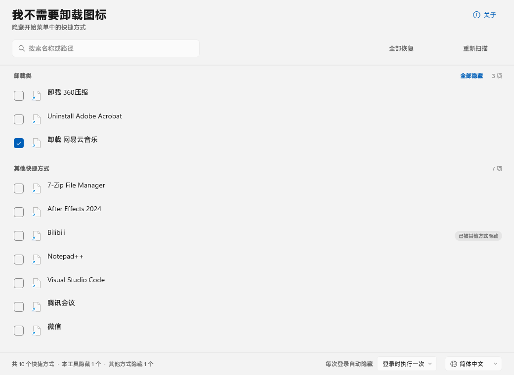
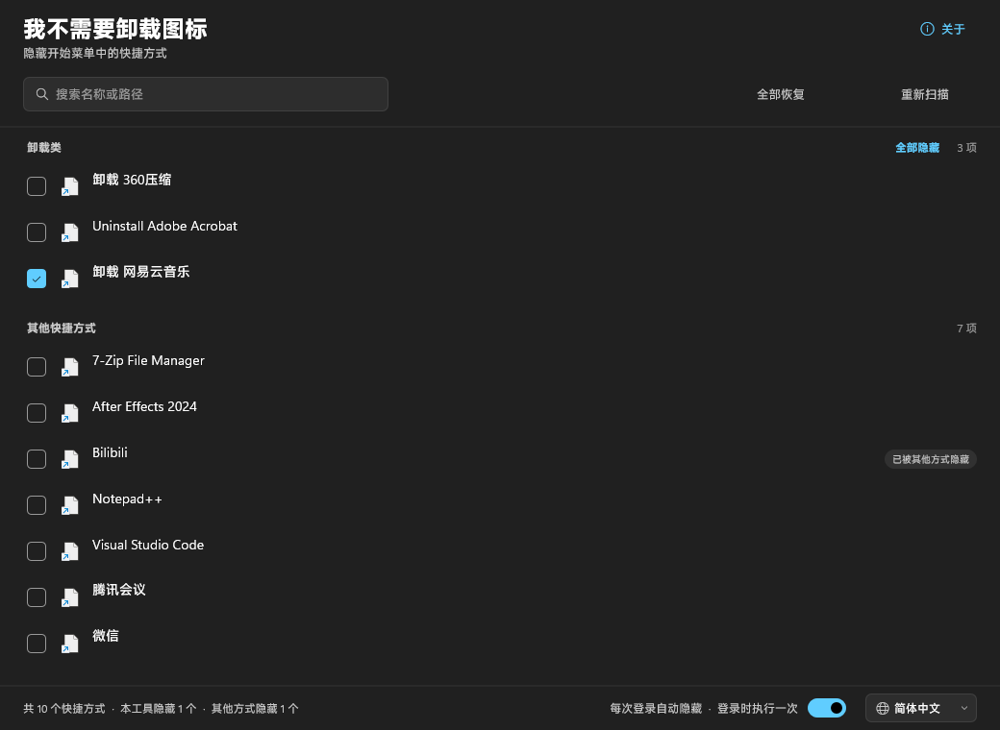
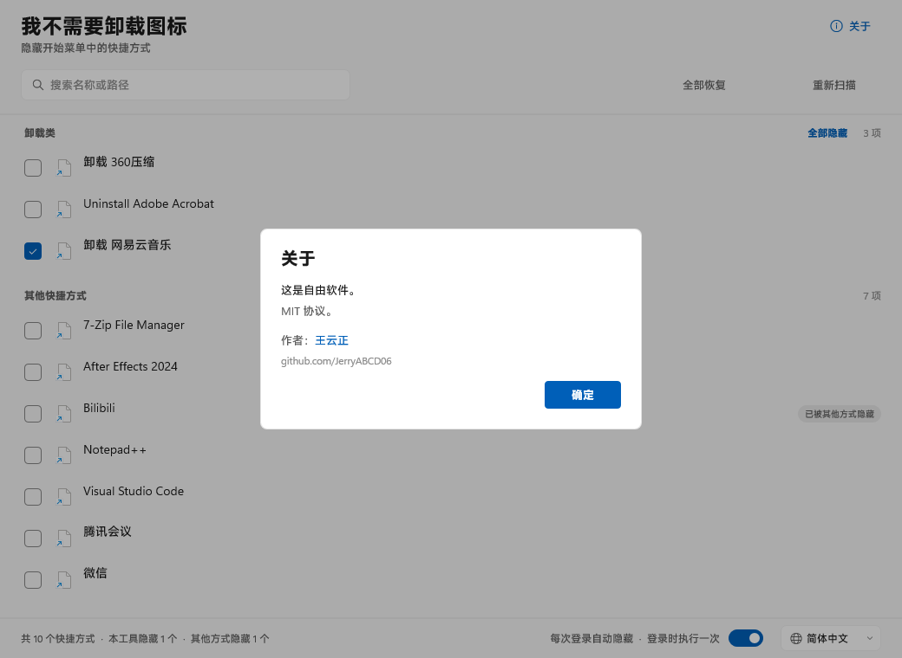
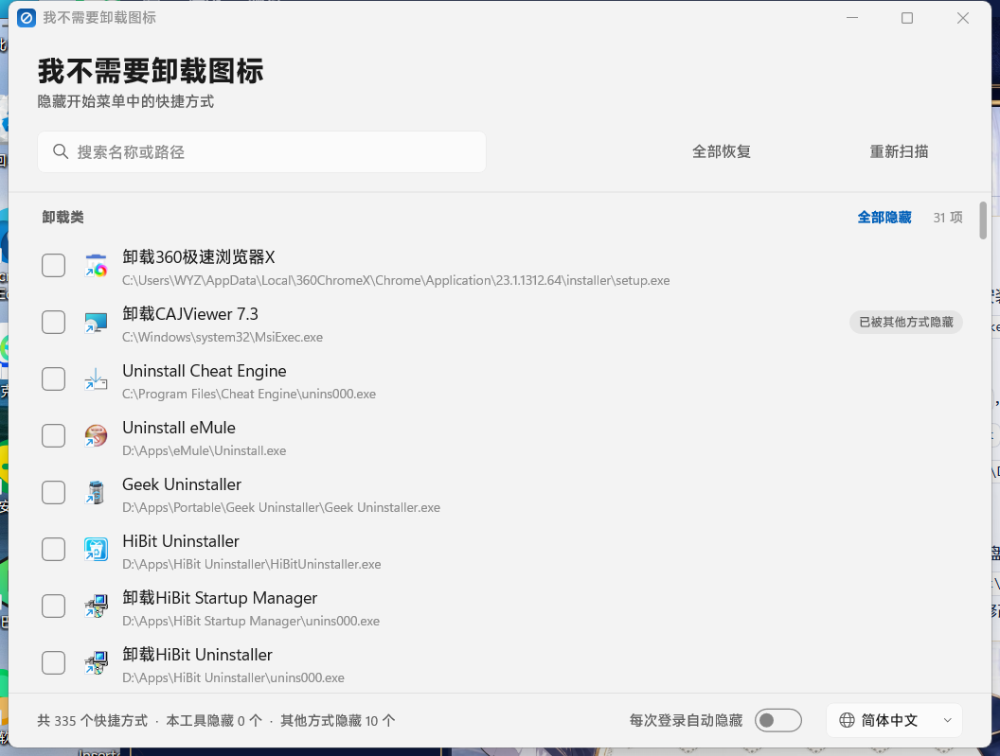

# 我不需要卸载图标（No Uninstall Icon）

[English](README.md) | **简体中文**

一个零依赖的小工具：给快捷方式文件打上 `FILE_ATTRIBUTE_HIDDEN` 属性，让选中的开始菜单项从列表里消失。

只用 C++20 和 Windows SDK 编写：没有 .NET，没有 Electron，没有任何第三方库。窗口用 Direct2D/DirectWrite 绘制，画在 DirectComposition 表面上，因此可以使用 Windows 11 的 Mica 材质。

支持 64 位 Windows 10（1809 及以后）和 Windows 11。运行它不需要安装任何东西：可执行文件是自包含的；系统提供 Mica 时就用 Mica，不提供时用普通背景。



| 深色主题 | 关于对话框 | 真实窗口（Mica） |
|---|---|---|
|  |  |  |

## 文档

本 README 是概览，细节都在 `docs/` 里。第一次读代码的话，建议先看 *架构*，再看 *渲染层*。

| 文档 | 内容 |
|---|---|
| [docs/architecture.md](docs/architecture.md) | 两个进程、状态机、共享对象、加锁与对账规则、线程图、模块职责表、两段端到端流程、术语表 |
| [docs/state-file.md](docs/state-file.md) | 程序写出的每一个文件：`state.dat` 的语法与转义、`state.lock`、日志、崩溃转储，以及**没有**存下来的东西 |
| [docs/win32-notes.md](docs/win32-notes.md) | 只在 Windows 上才麻烦的部分：托盘协议版本 4、完整性级别与 UIPI、DPI、DirectComposition 与 Mica、手写命中测试、UI Automation、计划任务的逐项设置 |
| [docs/build.md](docs/build.md) | 构建、版本号写在哪几处、签名策略、打包、卸载顺序、语言文件格式 |
| [docs/testing.md](docs/testing.md) | 环境变量、测试模式、自检配方、哪些东西无法在无头会话里验证、一份五分钟手工检查单 |
| [docs/troubleshooting.md](docs/troubleshooting.md) | 症状 → 原因 → 怎么查，从"如何打开日志"讲起 |
| [docs/internals.md](docs/internals.md) | 渲染层：D3D11/D2D/DirectComposition 栈、Mica、Painter、布局常量、显示列表与列表为什么便宜、图标工作线程、离屏渲染 |

## 它能做什么

* 枚举用户与所有用户两个开始菜单目录下的全部 `.lnk` 和 `.url`
  （`FOLDERID_Programs` 与 `FOLDERID_CommonPrograms`，通过已知文件夹 API 解析，因此重定向的配置文件也能正常工作）。
* 把列表分成两组：名字或目标看起来像卸载项的，以及其余所有。两组都用用户自己的排序规则
  （`CompareStringEx` + `SORT_DIGITSASNUMBERS`），所以中文按拼音排、日文按假名排、`App 2` 排在
  `App 10` 前面。排序前会先去掉开头或结尾的"卸载"类词，因此 `卸载 Visual Studio Code` 会排在 *V* 下面。
* 复选框的含义是**"隐藏这个快捷方式"**。它只反映本工具管理了什么，从不反映文件当前的属性。
* 勾选立即生效，并附带一个可撤销的提示条。
* 可选的"登录时自动隐藏"：一个计划任务，登录时触发且不会弹 UAC，重新应用列表。可以选择每次登录应用一次，也可以常驻监视目录变化。

## 三种状态，而不是两种

这是让工具可以放心使用的地方：

| 状态 | 复选框 | 标记 |
|---|---|---|
| 未隐藏 | 未勾选 | – |
| 被别的东西隐藏了（安装程序、其它工具、用户自己） | 未勾选 | "已被其它方式隐藏" |
| 由本工具管理 | 勾选 | – |

每条管理记录都保存着快捷方式的**原始属性**。取消勾选时恢复原来那个隐藏位，而不是粗暴地清除它——所以一个在本工具动手之前就已经隐藏的快捷方式，被释放之后仍然是隐藏的。

## 使用窗口

列表里是两个开始菜单目录下的全部内容，分两组：*卸载项* 和 *其它快捷方式*。每组标题上显示条目数；卸载组的标题上还有 **全部隐藏 / 全部恢复**。工具栏上有 **全部恢复** 和 **重新扫描**；搜索框随输入实时过滤名称与路径；底栏汇报总数（`335 个快捷方式 · 本工具隐藏 0 个 · 其它方式隐藏 11 个`）。

模式下拉框就是"自动隐藏"的开关：

| 模式 | 作用 |
|---|---|
| 关闭 | 后台什么都不跑，登录任务被移除 |
| 每次登录一次 | 每次登录运行一次 `--apply`，然后退出 |
| 持续监视 | 运行 `--background`：开始菜单变化时重新应用，并显示托盘图标 |
| 监视（无托盘图标） | 同上，但不显示图标 |

语言下拉框第一项是 **跟随系统**——跟随 Windows 显示语言——后面是内置的全部语言。选择后立即生效并被记住。

右键点击某一行，可以切换隐藏状态，或选择 *打开快捷方式位置*。

### 键盘

| 按键 | 行为 |
|---|---|
| `↑` / `↓` | 上移/下移一项 |
| `Home` / `End` | 第一项 / 最后一项 |
| `PgUp` / `PgDn` | 上翻/下翻一屏，选中项随之移动 |
| `空格` | 隐藏或恢复选中项 |
| `Enter` | 打开选中快捷方式的位置 |
| `菜单键`、`Shift+F10` | 为当前焦点打开右键菜单 |
| `Ctrl+F` | 跳到搜索框 |
| `Tab` / `Shift+Tab` | 在搜索框、列表和工具栏之间切换 |
| `Esc` | 在搜索框内：先清选区，再清文本，再退出搜索框；否则关闭"关于"对话框 |

### 托盘菜单

当模式会显示图标时，通知区域的菜单只有两条命令：**打开**（单击或双击图标也可以）和 **退出**。
退出会先关闭窗口，然后移除图标并停止监视进程——它**不改变模式**，所以下次打开窗口或下次登录时，监视会重新开始。

## 它管不到的地方

* **固定到开始屏幕的磁贴。** 固定项单独存放（`Quick Launch\User Pinned\StartMenu` 以及注册表/CloudStore 里的列表），所以隐藏"所有应用"里的快捷方式并不会取消固定。受影响的只有"所有应用"列表。
* **打包应用（Store/UWP）。** 它们没有快捷方式文件，无法用这种方式隐藏。
* **资源管理器的"显示隐藏文件"** 在某些版本上会让隐藏的快捷方式重新可见；本工具不会去对抗这个设置。

## 文件

| 路径 | 用途 |
|---|---|
| `%LOCALAPPDATA%\NoUninstallIcon\state.dat` | 管理记录与设置（制表符分隔、带转义、原子替换） |
| `%LOCALAPPDATA%\NoUninstallIcon\state.dat.bak` | 上一次保存的副本，主文件损坏时使用 |
| `%LOCALAPPDATA%\NoUninstallIcon\state.lock` | 空文件，用于跨会话加锁 |
| `%LOCALAPPDATA%\NoUninstallIcon\log.txt` | 只有 `--log` 或 `NOUI_LOG=1` 时才写；超过 1 MB 会被删除 |
| 计划任务 `NoUninstallIcon-AutoHide` | 登录任务，只有用户主动启用时才创建 |

## 便携模式

在 `NoUninstallIcon.exe` 旁边放一个名为 `portable` 的文件，程序就会把所有东西放在 `<exe 所在目录>\data` 里，而不是用户配置文件目录。`dist/` 里的便携包自带这个标记文件；删掉它就回到常规位置。如果那个目录不可写（光盘、被锁的共享），程序会退回 `%LOCALAPPDATA%`，而不是直接失败。

`NOUI_DATA_DIR` 会覆盖以上两种选择，测试用的就是它。

压缩包里还有 `Reset.cmd`。运行它会撤销程序做过的一切——每个被隐藏的快捷方式恢复原始属性、登录任务被移除、监视进程停止——但不删除程序本身。它会请求一次提权，因为 `%ProgramData%` 下的快捷方式和计划任务需要管理员权限。这就是便携版的"卸载等价物"：之后那个文件夹随你删。

登录任务里存的是绝对路径，所以从可移动磁盘启用自动隐藏后，盘符一变就会失效。

## 构建

打包、版本号和签名都在 [docs/build.md](docs/build.md) 里。

依赖：MSVC（VS 2022/2026，含 C++ 桌面工作负载）和 Windows 10/11 SDK。不使用任何 NuGet 包。

```bat
build.bat            :: 发布版，未签名
build.bat debug      :: 调试版
build.bat sign       :: 顺便用 .signing\NoUninstallIcon.pfx 签名
```

产物：`build\NoUninstallIcon.exe`（约 560 KB，静态链接 C 运行库）。

签名只用于本地测试。自签名二进制携带的发布者是"王云正"，但没有到受信任根的证书链，Windows 会把它显示为未知发布者，SmartScreen 对它的信任程度并不比未签名文件更高；所以发布版保持未签名，`tools\package.ps1` 也会拒绝打包已签名的构建。

## 安装程序

卸载顺序与清理钩子在 [docs/build.md](docs/build.md) 里。

```bat
powershell -File tools\package.ps1        :: 安装包与便携压缩包，未签名
```

产物：`dist\NoUninstallIcon-Setup-0.1.1.exe` 和
`dist\NoUninstallIcon-portable-0.1.1.zip`。安装程序跟随系统深浅色，提供程序支持的全部十一种语言，并按所选语言显示产品名。它**不会**往开始菜单里放"卸载"快捷方式：那个菜单正是本程序要清理的地方。要移除本产品，请用 *设置 → 应用*。卸载程序会先运行 `NoUninstallIcon.exe --cleanup`，删除登录任务并让每个受管理的快捷方式恢复原始属性。

## 命令行

| 参数 | 含义 |
|---|---|
| *（无）* | 正常窗口。会自我提权重启一次。 |
| `--apply` | 静默应用已保存的列表并退出（登录任务用）。 |
| `--watch`、`--background` | 运行监视进程：先应用一次，然后监视两个开始菜单目录，变化时重新应用。当存储的模式要求时持有托盘图标。 |
| `--background --no-tray` | 同上，且无论模式如何都不显示图标。 |
| `--restore` | 恢复所有受管理的快捷方式并遗忘它们。 |
| `--cleanup` | 删除登录任务，然后 `--restore`（卸载程序用）。 |
| `--stop-watcher` | 请正在运行的监视进程退出，不碰存储的模式（安装程序在替换可执行文件前用它）。 |
| `--screenshot <png> [--theme light\|dark] [--about]` | 离屏渲染窗口，用于测试。 |
| `--capture <png>` | 显示真实窗口，截图到 PNG，然后退出。 |
| `--dump <txt>` | 扫描并写出分类报告。 |
| `--selftest` | 隐藏/恢复一个测试条目并校验各项不变式。 |
| `--log` | 写 `log.txt`。也会传给它启动的监视进程和提权后的窗口副本。`NOUI_LOG=1` 从环境变量达到同样效果；`NOUI_LOG=0` 保持关闭。 |

监视进程**服从**存储的模式，而不是自己选择模式。模式为 *关闭* 或 *一次* 时它什么都不做直接返回，因为这两种模式的定义就是没有监视进程；只有 *持续监视* 和 *静默监视* 需要它。`--background` 是登录任务运行的那个，`--watch` 是可接受的别名，两者都不会把模式打开：模式在窗口里设置，并存在 `state.dat` 里。

`--screenshot`、`--dump` 和 `--selftest` 不请求提权。`--screenshot` 和 `--dump` 不改变任何东西。`--selftest` 会隐藏并恢复一个测试条目，所以运行前把 `NOUI_DATA_DIR` 和 `NOUI_SCAN_ROOT` 指向临时目录。`--capture` 渲染真实窗口，也就意味着它会执行启动对账：同样建议配合临时数据目录使用。

## 各部分如何达成一致

完整模型（含加锁与对账规则）在 [docs/architecture.md](docs/architecture.md) 里。

持久化的真相只有一份：`state.dat`。其它一切都是从它派生出来的，都可以由它重建。

| 模式 | 登录任务 | 监视进程 | 托盘图标 |
|---|---|---|---|
| 关闭 | 无 | 无 | 无 |
| 一次 | `--apply` | 无 | 无 |
| 持续监视 | `--background` | 一个 | 显示 |
| 监视（无图标） | `--background` | 一个 | 无 |

任务总是启动一个普通的 `--background` 监视进程；图标是否出现取决于它被告知的模式，而不是它被怎么启动。手工用 `--no-tray` 启动的监视进程在任何模式下都不会显示图标。

写入方分两级串行化：一个会话级命名互斥体，以及数据文件旁 `state.lock` 上的字节区间锁（尽力而为：目录只读时仅有会话互斥体也仍然成立），因为互斥体是每会话的，而 `state.dat` 是每用户的，甚至可能放在共享盘上。同一线程上的嵌套事务（撤销会调用切换流程）共享外层文件锁。

模式通过一小块共享内存（`Local\NoUninstallIcon.State`，一个版本号加模式值）以及一个手动重置事件（`Local\NoUninstallIcon.Changed`）传递。手动重置意味着"没人在听的时候发布的变更，之后仍然能看到"；监视进程在读取模式**之前**先清除事件，所以读取期间落地的发布会把事件重新置位，不会丢失。用共享内存而不是窗口消息，是因为监视进程以提权身份运行，而窗口消息在完整性级别之间会被过滤。

监视进程从不写状态文件。以前应用隐藏属性时也会顺便保存，这会改写它并不拥有的设置，可能把窗口里刚做的模式变更回滚掉；现在"已应用时间戳"只在窗口保存时写入。

所有权的划分阻止两个进程互相拆台：

- **窗口**写任务、写状态文件，并决定是否应该存在一个监视进程。
- **监视进程**拥有自己的图标，应用隐藏属性，并在发布的模式不再需要它时退出。它从不写任务。
- **修复动作从不改变模式。** 重新添加丢失的图标、启动缺失的监视进程都属于派生工作；只有下拉框和托盘的"退出"会碰模式。

对账发生在这些时刻：

| 触发 | 谁 | 修复什么 |
|---|---|---|
| 启动 | 窗口 | 重建缺失的任务，启动缺失的监视进程 |
| 模式变更 | 窗口 → 监视进程 | 监视进程增删图标或退出；不重启进程 |
| `TaskbarCreated` | 监视进程 | 资源管理器重启后重新添加图标 |
| 托盘"退出" | 监视进程 | 先关窗口、等它退出，然后自己退出；模式保持不变 |

窗口关着时监视进程挂掉，要等到下次启动或下次登录才会被发现。按设计没有第三个看门狗进程。尚未实现：窗口开着时监视进程挂掉也不会被发现。修法是持有监视进程所拥有互斥体的句柄并等待它，这样所有者退出时等待就会返回；那是内核通知而不是轮询，但目前还没有做。

广播里只走模式；快捷方式记录仍然是监视进程应用时从磁盘读取的，因为几百条记录不该塞进一条消息里。

## 为什么是两个进程

窗口是 Direct3D 11 / Direct2D / DirectComposition 程序。在发布版上实测：82.0 MB 工作集、57.2 MB 私有内存、112 个已加载模块。监视进程完全不碰图形 API，14.3 MB 工作集、**2.5 MB 私有内存**、40 个模块。

窗口只在改设置时开着。其余时间，这个产品的常驻成本就是监视进程那 2.5 MB。

这就是拆分的全部理由。合成一个进程要么把图形栈一直留在内存里（57 MB），要么每次隐藏窗口就销毁并重建设备，还要处理随之而来的设备丢失。

代价就是上一节里的全部东西：传递模式的共享内存与事件、围绕状态文件的命名锁、两个单实例互斥体，以及启动时的一轮对账。这个代价是有界的，因为程序只有四种模式、一个监视进程和一个托盘图标，不会再长大。把它合并回一个进程，对于更轻量的界面来说是合理选择；这里考虑过，因为内存而否决了，而不是因为复杂度小。

## 托盘图标

协议细节在 [docs/win32-notes.md](docs/win32-notes.md)。

`src/tray.cpp` 独占它；程序里没有别的地方碰 `Shell_NotifyIcon`。

- 图标窗口总是被创建；图标是否出现跟随模式，所以切换模式从不需要重启进程。
- 那是一个真正的（但从不显示）顶层窗口。消息专用窗口看起来也可以，但 shell 无法把点击投递给它。
- 每次 `NIM_ADD` 之后，图标都会切换到 `NOTIFYICON_VERSION_4`。这一点很关键：在版本 4 里，右键是以 **`WM_CONTEXTMENU` 出现在回调 `lParam` 的低位字**里到达的，锚点打包在 `wParam` 里。只盯着 `WM_RBUTTONUP` 的代码根本看不到这次点击。
- 因为监视进程以提权身份运行，需要用 `ChangeWindowMessageFilterEx`（以及更旧的 `ChangeWindowMessageFilter`）允许中等完整性的 shell 往窗口投递消息。
- 双击打开主窗口；如果已经有一个开着，就改为激活它，并因为后台进程不能自行抢占前台而附加到它的线程。
- `TaskbarCreated` 让资源管理器重启后把图标放回去。
- 权限保持一致：登录任务以最高运行级别启动监视进程，窗口和后续任何监视进程都继承该级别，所以日常使用中不会再弹额外的提权提示。

## 为什么用计划任务而不是服务

服务运行在 session 0，不做模拟就看不到已登录用户的 `HKCU` 开始菜单，启动时机早于 shell 存在，而且安装与移除都更麻烦。一个 `RunLevel=HighestAvailable`、主体为 `InteractiveToken` 的计划任务，可以在登录时以提权身份启动而不弹 UAC——这正是需要的。

一次性模式等 20 秒再应用。监视模式还会响应 `FindFirstChangeNotificationW` 通知，所以被安装程序重建的快捷方式会在一秒内被重新隐藏。

## 测试

环境变量、测试模式和手工检查单在 [docs/testing.md](docs/testing.md) 里。

```bat
set NOUI_DATA_DIR=%TEMP%\noui
set NOUI_SCAN_ROOT=%TEMP%\noui\menu
NoUninstallIcon.exe --selftest
type %TEMP%\noui\selftest.txt
```

`NOUI_SCAN_ROOT` 把扫描器指向一个测试文件夹而不是真实的开始菜单，所以测试永远不会碰真实快捷方式。

## 本地化

所有界面字符串都在 `res/lang/*.lang` 里，以 `RCDATA` 形式嵌入。目前内置十一种语言：英语、德语、法语、西班牙语、意大利语、巴西葡萄牙语、俄语、韩语、日语、简体中文和繁体中文。缺失的键回退到英语，没有翻译的区域设置也回退到英语。`tools/check-lang.ps1` 在 `build.bat` 结尾运行，报告任何键集合与 `en.lang` 不一致的文件。

`res/lang/map.txt` 把 Windows 区域设置映射到语言文件（`zh-CN`、`zh-SG`、`zh-MY` 都表示简体中文）。最长前缀优先，其次是主语言子标签，最后是英语。增加一种语言只需要一个 `.lang` 文件加一行 `RCDATA`：表在启动时被发现，不需要改代码。选择器第一项是"跟随系统"，每次启动都跟随当前区域设置。

## 关于对话框

标题右侧的 **关于** 会打开一个窗口内的对话框——一个 Fluent `ContentDialog` 风格的卡片，而不是 `MessageBox`——其中写明许可，并链接到作者的 GitHub 主页。按 Esc、点确定，或在卡片外点一下即可关闭。

## 许可

MIT。Copyright (c) 2026 王云正 (JerryABCD06)。见 [LICENSE](LICENSE)。

安装程序使用 [Inno Setup](https://jrsoftware.org/isinfo.php)（作者 Jordan Russell 与 Martijn Laan）构建。其许可建议在产品文档中致谢，此处即为该致谢；本项目没有再分发 Inno Setup 的任何内容，只分发它产出的安装包。

## 如果它崩溃了

程序安装了一个顶层异常过滤器。遇到未处理异常时，它会在 `state.dat` 旁边写出 `crash-YYYYMMDD-HHMMSS.dmp` 和 `crash.txt`（异常码与出错地址），然后退出。报告问题时请附上转储文件——这是区分线程 bug 和绘制 bug 的唯一办法。普通日志默认关闭；需要还原事件顺序时，用 `--log` 运行，或设置 `NOUI_LOG=1`。两者都能挺过自我提权，也都能到达从窗口启动的监视进程。由登录任务启动的监视进程从不记日志，因为任务没有命令行可以继承。

开关的细节：

| `NOUI_LOG` | `--log` | 是否写日志 |
|---|---|---|
| 未设置 | 无 | 否 |
| `1`（或除 `0` 外的任何值） | 无 | 是 |
| 未设置或 `0` | 有 | 是 |
| `0` | 无 | 否 |

命令行参数优先于环境变量。当你在某个 shell 里全局设置了该变量、而某一次运行希望安静时，`NOUI_LOG=0` 很有用。

更多内容见 [docs/troubleshooting.md](docs/troubleshooting.md)，它从"如何读日志"和"每种故障长什么样"讲起。
